# Where am I? What's here?
1) Print Working Directory
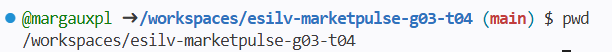

2)List files and folders
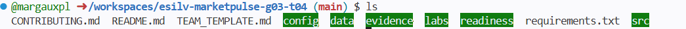
3 & 4)long format: size, date, rights & all: also hidden files (start with a dot)
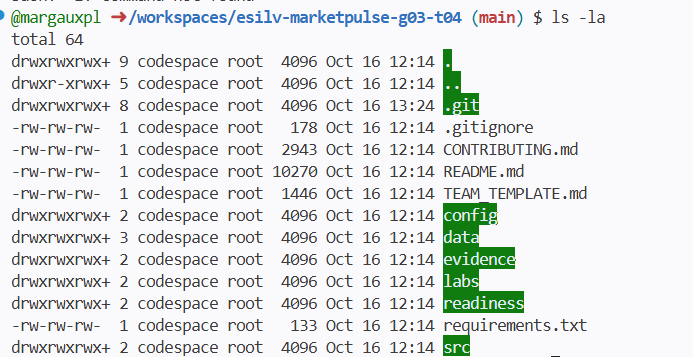

# Moving around with cd
1)go into data
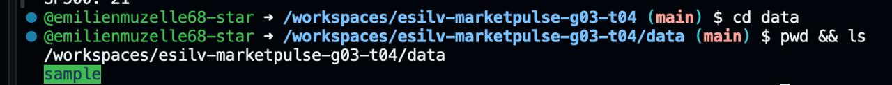
2)go up one level 
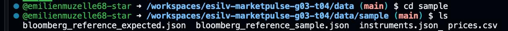
3)go up two levels
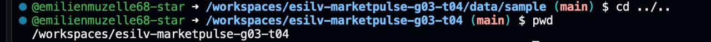

# cat displays a whole file
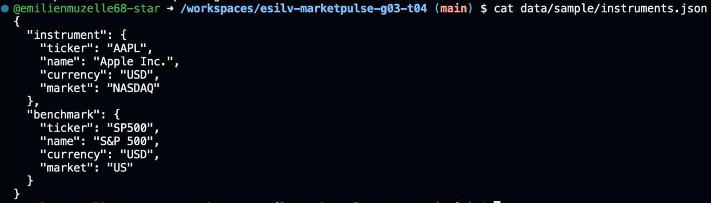
1. What is the instrument?

The instrument is the Apple Inc. stock, with the ticker AAPL.
 
2. What is the benchmark?

The benchmark is the S&P 500.

3. Where are their names and tickers stored?

Their names and tickers are stored in the instruments.json file, which is located in the data/sample/ directory.

# head shows the first 10 lines
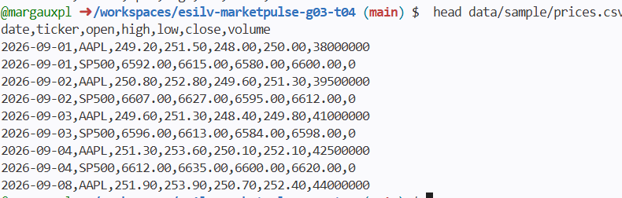

# grep searches for a word
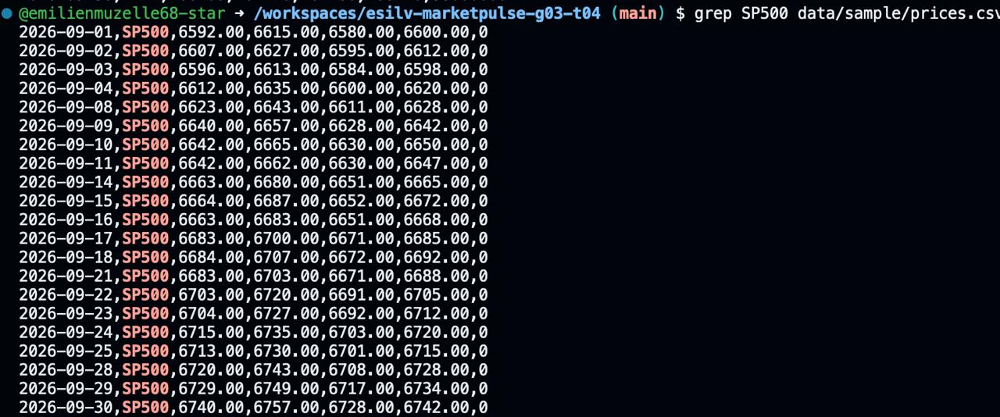
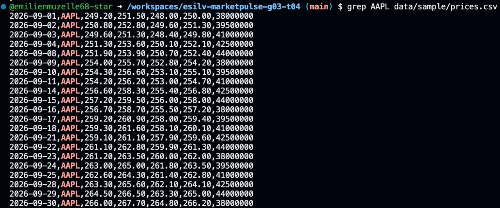

# From the repository root

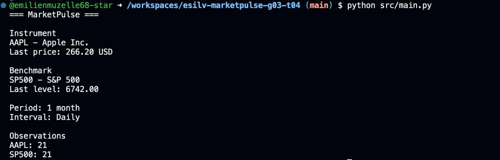

