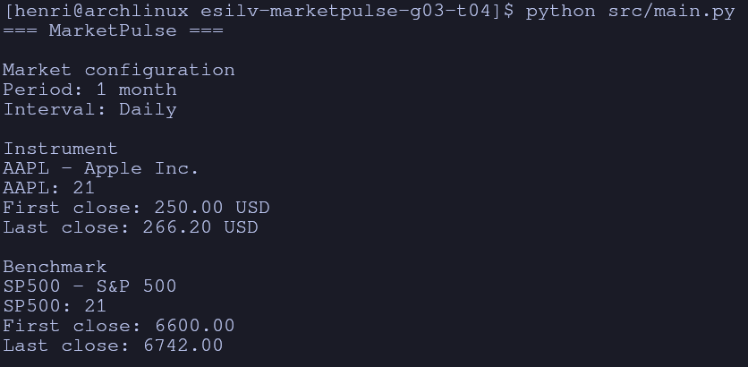

## main.py review
1. Which function reads JSON?
```python
def load_instruments():
```
2. Which function reads CSV?
```python
def load_prices():
```
3. Which one selects one ticker?
```python
def filter_prices(prices, ticker):
```
4. Which one coordinates execution?
```python
def main():
```
5. Where are the input files stored?
`/data

## Write 2 small helpers
### Obtaining 1st price
```python
def get_first_close(prices):
    return prices[0]["close"]
```
### Obtaining last price
```python
def get_last_close(prices):
    return prices[-1]["close"]
```
## Make reusable summary
```python
def display_market_summary(asset, prices, show_currency=True):
    print(f"{asset['ticker']} - {asset['name']}")
    print(f"{asset['ticker']}: {len(prices)}")
    print(f"First close: {get_first_close(prices)}", (asset['currency'] if show_currency else ''))
    print(f"Last close: {get_last_close(prices)}", (asset['currency'] if show_currency else ''))
```
## Final run
```python
def main():
    instruments = load_instruments()
    prices = load_prices()

    instrument = instruments["instrument"]
    benchmark = instruments["benchmark"]

    instrument_prices = filter_prices(prices, instrument["ticker"])
    benchmark_prices = filter_prices(prices, benchmark["ticker"])

    print("=== MarketPulse ===")
    print()
    print("Market configuration")
    print(f"Period: {LOOKBACK_LABEL}")
    print(f"Interval: {INTERVAL_LABEL}")
    print()
    print("Instrument")
    display_market_summary(instrument, instrument_prices)
    print()
    print("Benchmark")
    display_market_summary(benchmark, benchmark_prices, show_currency=False)
    print()
    print()
```

