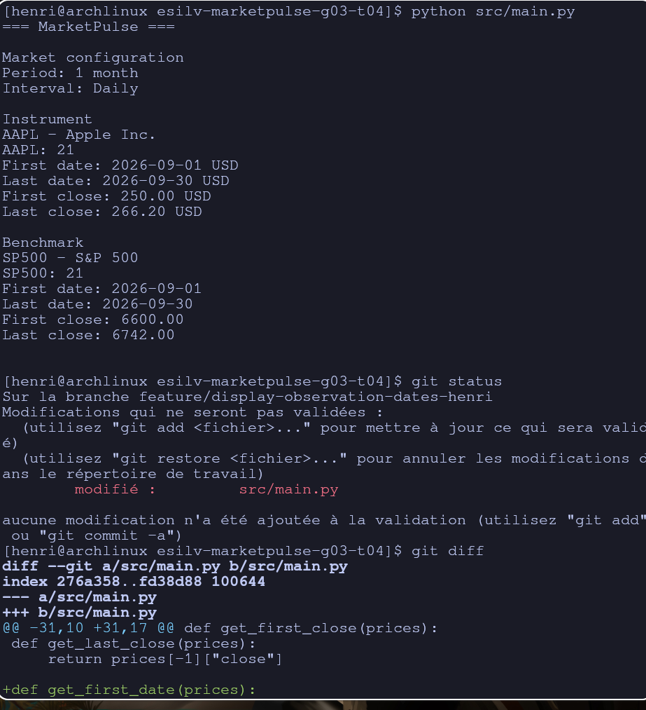
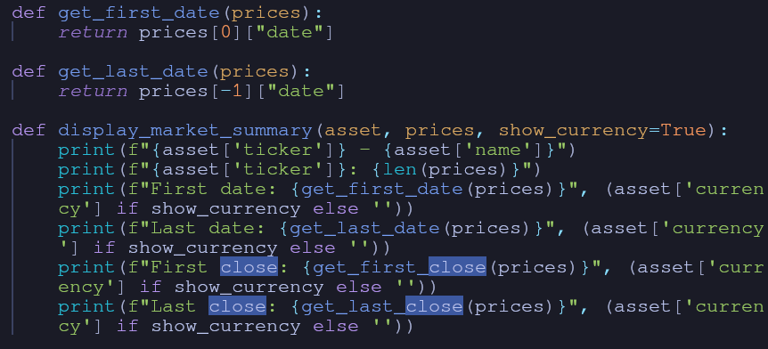
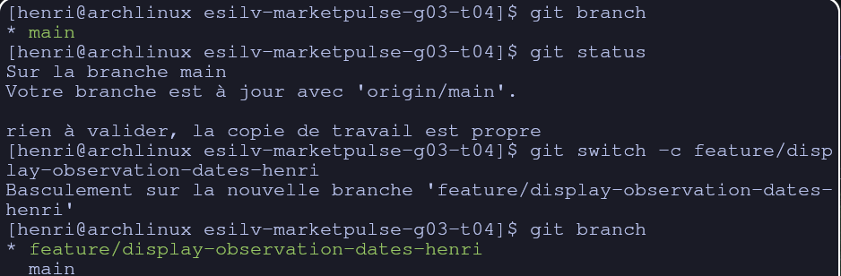
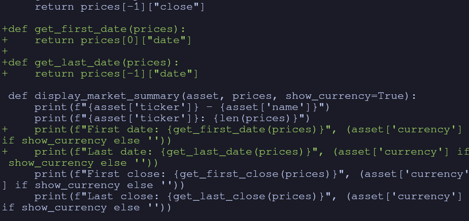
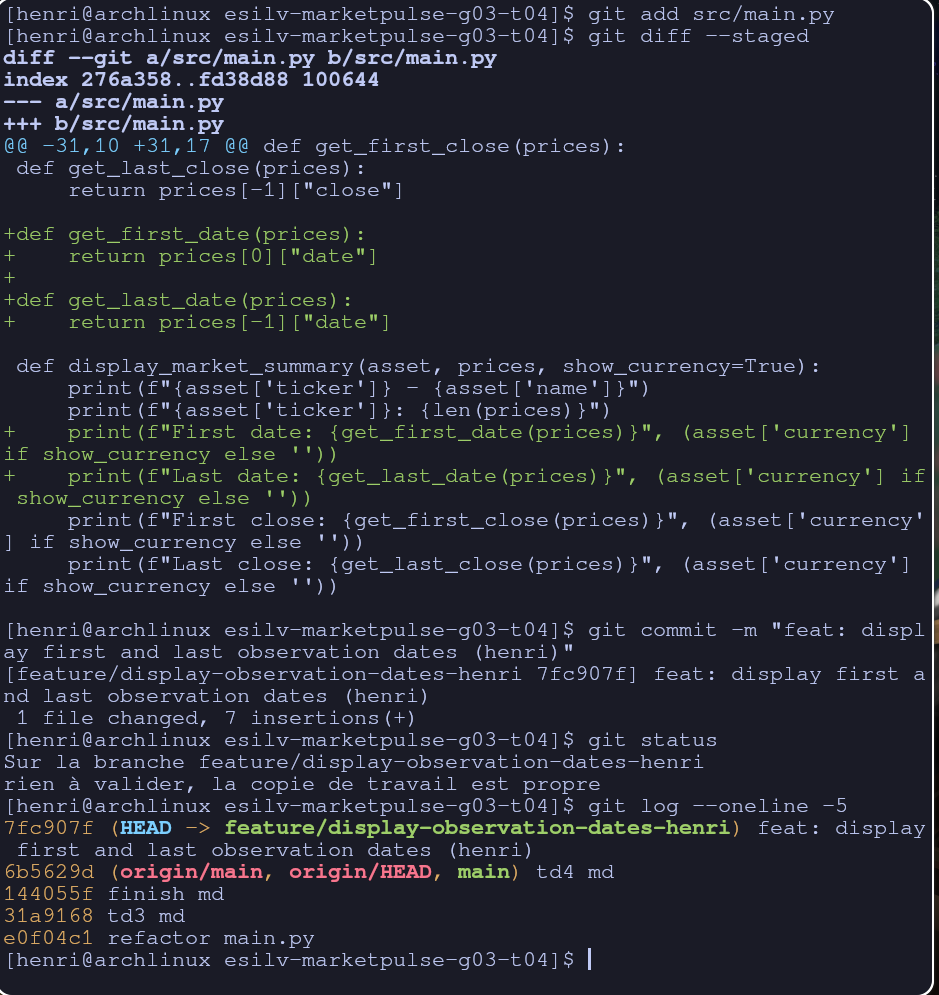
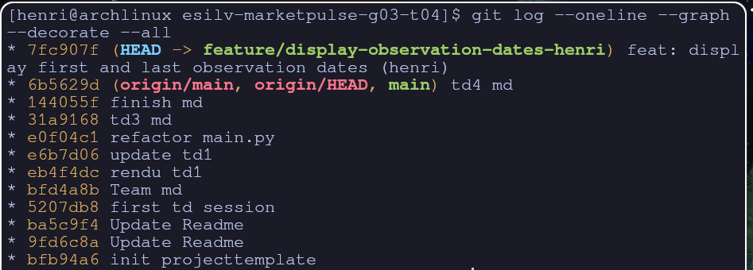
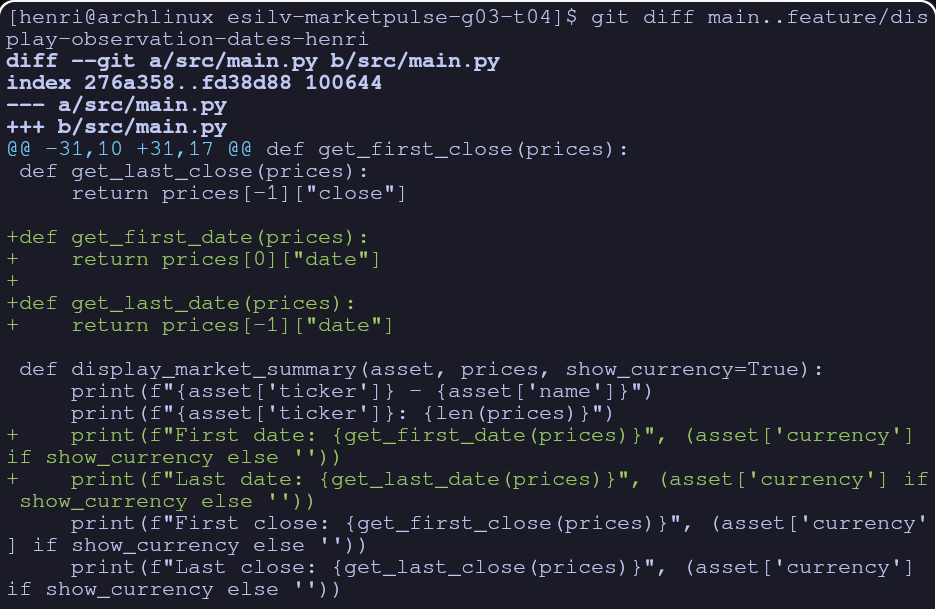
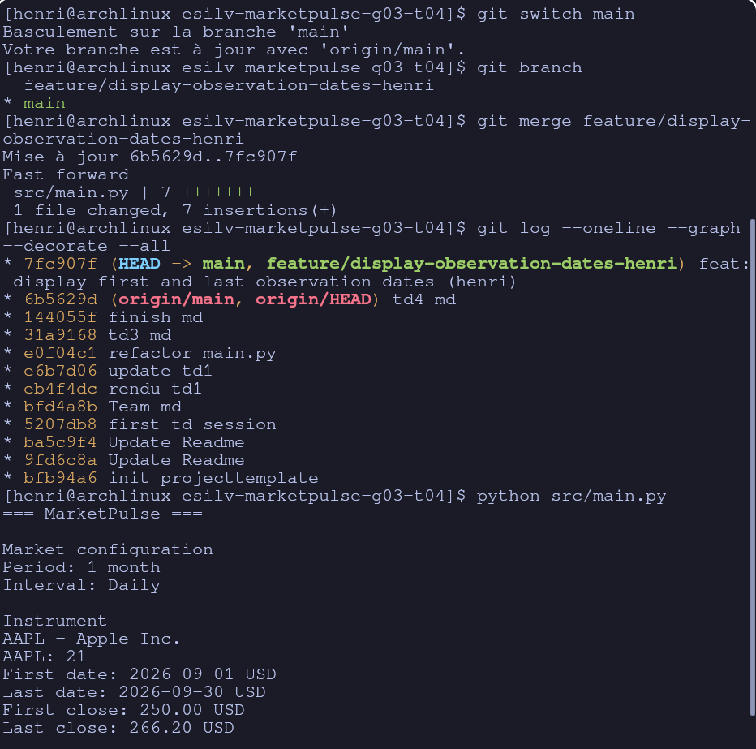
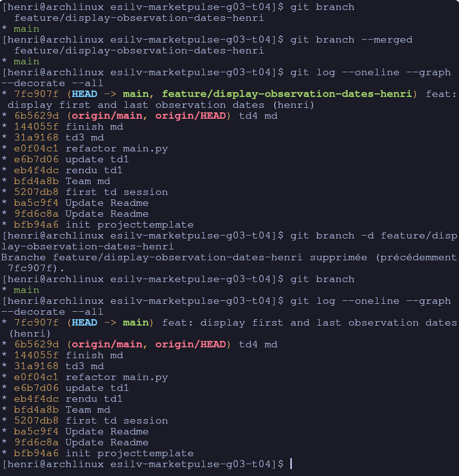

# TD 4 henri

1. Which change exists on the feature branch?
The one on main.py
2. Why is that change not yet part of `main`?
Because the changes are local on the current branch, and the current branch was not main
3. What would happen if the branch were abandoned before merge?
The changes would disappear

1. Is the feature now visible from `main`?

Yes, the local branch is now main, and the changes were merged
2. Is the feature commit still visible?
Yes, but it is now part of main
3. Did Git perform a fast-forward or create a merge commit?
it created a fast forward because it was possible, and it is the default option of main
4. What does the graph show?
It looks like everything happened under main
