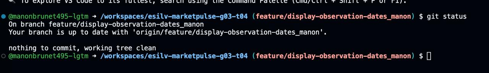
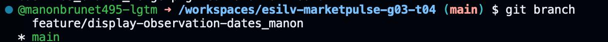
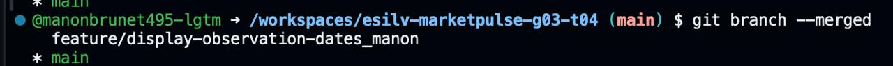
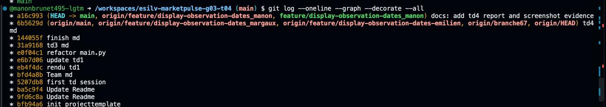
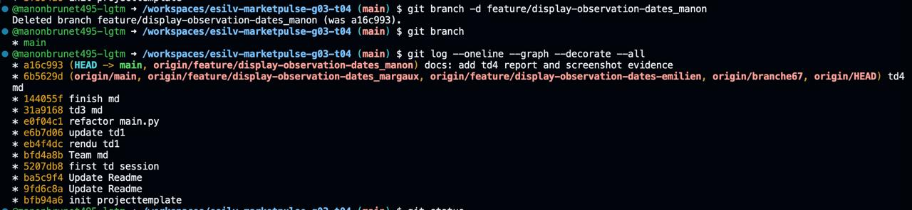

1. La fonctionnalité est-elle maintenant visible depuis main ?

Oui. Comme tu as exécuté git merge depuis la branche main, le code de la fonctionnalité (les dates d'observation) fait désormais partie de main. Quand tu lances python src/main.py, le programme exécute la version finale intégrée.

2. Le commit de la fonctionnalité est-il toujours visible ?

Oui. L'historique Git conserve tous les commits créés. Tu peux retrouver le commit de ta branche (ex: "feat: display first and last observation dates") directement dans la liste renvoyée par git log.

3. Git a-t-il effectué un Fast-Forward ou créé un commit de merge ?

Dans votre cas, il s'agit d'un Fast-Forward.
Pourquoi ? Parce qu'aucun autre commit n'a été fait sur main pendant que tu travaillais sur ta branche.
Comment Git réagit ? Au lieu de créer un nouveau commit de fusion (merge commit), Git a simplement déplacé l'étiquette (pointer) de la branche main tout au bout de ta branche de fonctionnalité.

4. Que montre le graphique (git log --graph) ?

Le graphique montre une ligne droite (historique linéaire).
Les étiquettes HEAD, main et feature/display-observation-dates sont désormais pointées sur le même commit tout en haut de la liste.