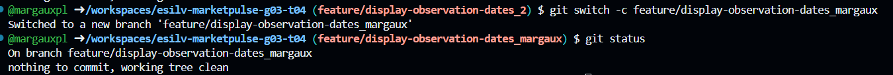
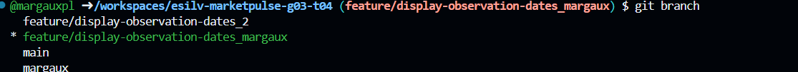
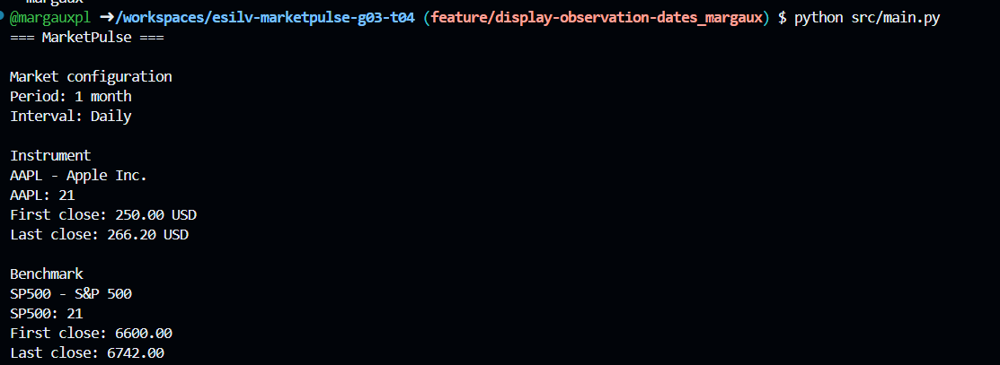
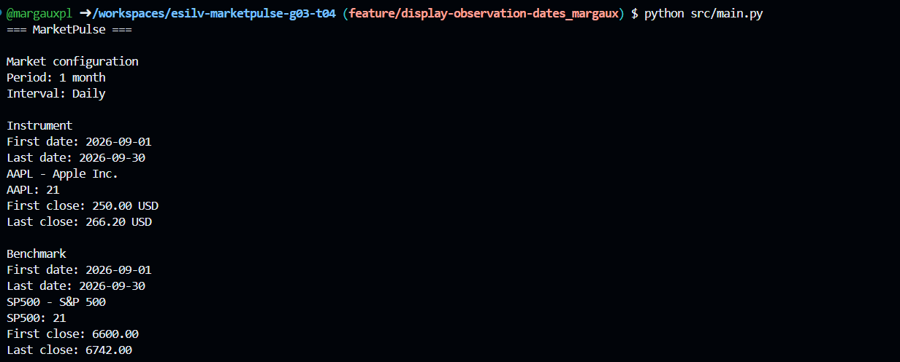
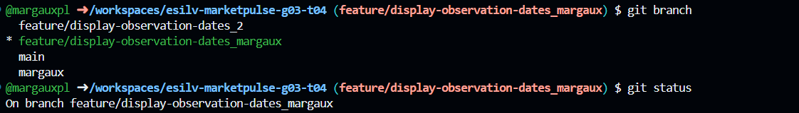
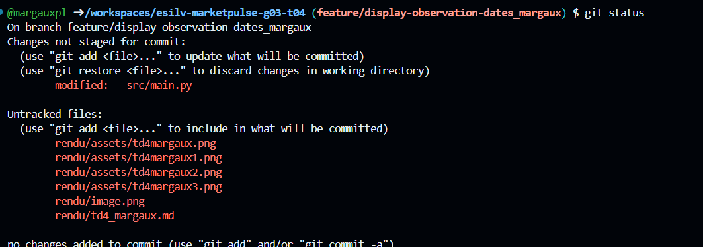
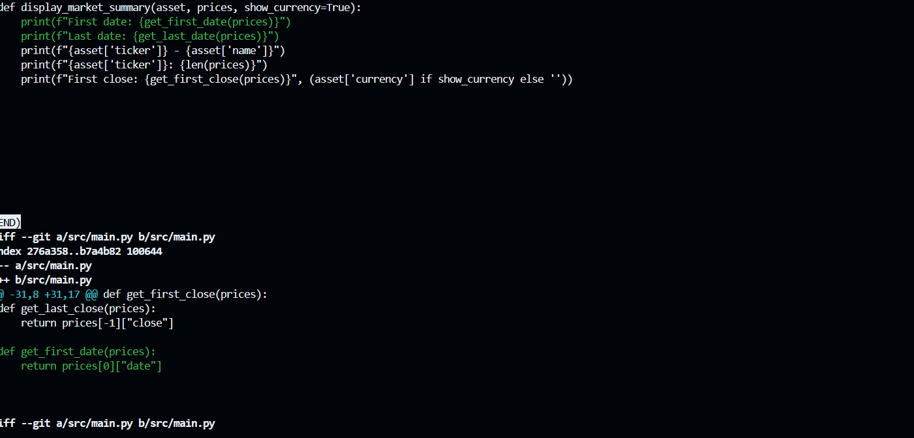
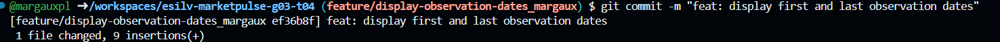

1. Is the feature now visible from `main`?

Yes. After merging the feature branch into main, the first and last observation dates are displayed for both the instrument and the benchmark.

2. Is the feature commit still visible?

Yes. The feature commit remains in Git history after the merge.

3. Did Git perform a fast-forward or create a merge commit?

A fast-forward merge occurs if main has no new commits since the feature branch was created. Also Git may create a merge commit. The actual result must be verified using the merge output.

4. What does the graph show?

The graph shows the commit history we can also see the relationship between main and the feature branch. And whether main now includes the feature commit. With a fast-forward merge the history remains linear.